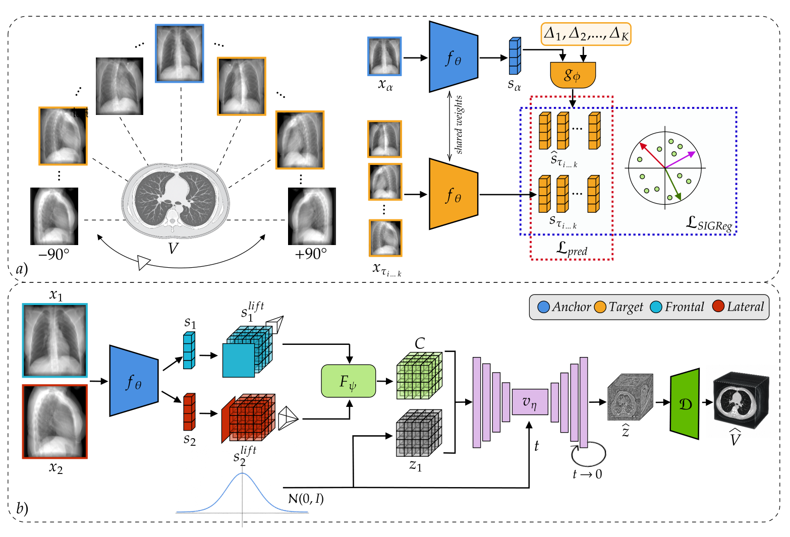
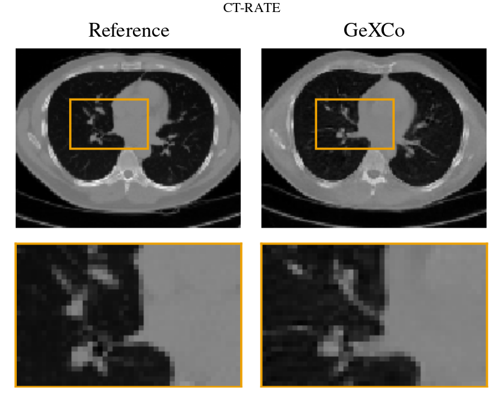

<div align="center">
  

  <h1>Geometry-Aware World-Model Conditioning<br/>for Biplanar X-Ray-to-CT Reconstruction</h1>

  <p><strong>Daniele Molino · Camillo Maria Caruso · Filippo Ruffini · Valerio Guarrasi · Paolo Soda</strong></p>

  <p>World-model representations · Calibrated ray lifting · Rectified-flow CT synthesis</p>

  <a href="https://github.com/danielemolino/GeXCo/actions/workflows/tests.yml"></a>
  <a href="#installation"></a>
  <a href="#installation"></a>
  <a href="LICENSE"></a>

  <p>
    <a href="#installation">Install</a> ·
    <a href="#tests-and-example">Test</a> ·
    <a href="#pipeline">Pipeline</a> ·
    <a href="#training">Train</a> ·
    <a href="#inference">Infer</a> ·
    <a href="#evaluation">Evaluate</a> ·
    <a href="#selected-results">Results</a> ·
    <a href="#citation">Cite</a>
  </p>
</div>

GeXCo reconstructs a **128³ CT volume in Hounsfield units from two orthogonal
radiographs**, using a pretrained visual world model and geometry-aware conditioning.

## Installation

Use **Python 3.11** for the reference installation. Git and a C/C++ compiler are
required for the pinned PyRadiomics source build. CUDA is used for training and
practical inference; the public smoke test runs on CPU.

```bash
git clone https://github.com/danielemolino/GeXCo.git
cd GeXCo
python3.11 -m venv .venv
source .venv/bin/activate
pip install -e .
gexco --help
```

[requirements.txt](requirements.txt) pins the dependencies and is also consumed
by [pyproject.toml](pyproject.toml). All stages are available as
`gexco <stage>` or `python -m gexco <stage>`.

## Tests and example

```bash
python -m pytest -q
python scripts/smoke.py --output-dir outputs/smoke
```

The **regression tests** and CPU smoke need no external weight download.
The smoke generates a procedural CT128 test fixture, renders it, exports
a 13-view HDF5 bank and loads an Any-Anchor sample with K=8. It contains no patient data.
Use a fresh output
directory for each run. See [tests](tests/README.md) for coverage.

## Pipeline

| Stage and instructions | Command | Main output |
|---|---|---|
| [Biplanar projections](gexco/data/README.md#drr-generation-and-hdf5-export) | `gexco make-drr` | Raw frontal/lateral TIFFs and geometry |
| [Acquired radiographs](gexco/data/README.md#acquired-radiographs) | `gexco prepare-xray` | DICOM → normalized 512²/128² TIFFs and inference manifest |
| [Multiview preparation](gexco/data/README.md#drr-generation-and-hdf5-export) | `gexco export-hdf5` | HDF5 shards and view manifests |
| [Any-Anchor pretraining](gexco/pretraining/README.md) | `gexco pretrain-wm` | World-model checkpoints and split/history |
| [Frozen VAE encoding](gexco/data/README.md#extract-ct-latents) | `gexco extract-latents` | MAISI latents and training manifest |
| [Conditional generation](gexco/reconstruction/README.md#training) | `gexco train-gen` | Rectified-flow checkpoints |
| [Two-view reconstruction](gexco/reconstruction/README.md#inference) | `gexco infer` | CT128 int16 HU NIfTIs |
| [Method-agnostic scoring](gexco/evaluation/README.md) | `gexco evaluate` | Per-case and aggregate metrics |

Copy a stage YAML from [the YAML defaults](gexco/configs/README.md) and set your local paths, then pass
`--config my_config.yaml`. The root `configs/` directory is a symlink to packaged
`gexco/configs/`; the same defaults remain available after installation.

## Method

GeXCo follows three stages:

1. **World-model pretraining.** A ViT learns angular transformations on a
   15-degree grid between radiographs of the same patient using an any-anchor
   joint-embedding predictive objective with `K=8` targets and SIGReg (lambda 0.1).
2. **Geometry-aware conditioning.** Frontal and lateral feature maps are
   lifted along calibrated projection rays into a shared three-dimensional
   latent grid and combined using adaptive per-voxel view fusion.
3. **Rectified-flow reconstruction.** A latent 3D denoiser transports Gaussian
   noise to a CT latent, which is decoded into the reconstructed volume.

<p align="center">
  
</p>

<p align="center"><em>
World-model pretraining and geometry-aware rectified-flow reconstruction.
</em></p>

<details>
<summary><strong>Abstract</strong></summary>

Reconstructing a three-dimensional computed tomography from a pair of two-dimensional chest radiographs could bring volumetric information to low-cost, point-of-care settings.
However, the problem is severely ill-posed, and existing methods trained under pixel-fidelity objectives tend to yield blurry, anatomically generic volumes.
We present GeXCo, a latent diffusion framework whose conditioning encoder is a self-supervised world model pretrained with a joint-embedding predictive objective: a view-predictor learns to transform the representation of an anchor radiograph to that of the same patient at an arbitrary target angle, producing features that encode both viewing geometry and patient identity.
A geometry-aware fusion module lifts the two orthogonal encoded views into a three-dimensional latent grid along the known projection rays, and a rectified-flow denoiser, conditioned on this volume, synthesizes the reconstruction.
On paired chest imaging from CT-RATE (in-distribution) and from LIDC-IDRI and RadChestCT (out-of-distribution), the method remains within 0.5 dB of the best competitor in volumetric PSNR while outperforming all compared methods with public implementations on realism, anatomy and pathology metrics.
On CT-RATE, it improves Fréchet Radiomic Distance by 16%, anatomical segmentation Dice by 12.5%, and mean Average Precision by 8% over the strongest competitor, with consistent gains on both out-of-distribution datasets.
A controlled, matched-capacity ablation identifies world-model pretraining and geometry-aware lifting as complementary contributors to these gains.

</details>

## Selected Results

GeXCo rows from Table I of the revised manuscript. HD95 is in millimetres;
NSD uses a 3 mm tolerance. LIDC-IDRI has no classification labels (—).

| Dataset | Volume PSNR ↑ | Volume SSIM ↑ | Reproj. PSNR ↑ | Reproj. SSIM ↑ | FRD ↓ | Dice ↑ | HD95 (mm) ↓ | NSD@3 mm ↑ | AUROC ↑ | AP ↑ |
|---|---:|---:|---:|---:|---:|---:|---:|---:|---:|---:|
| CT-RATE | 20.51 | 0.562 | 20.71 | 0.818 | 6.56 | 0.611 | 13.90 | 0.641 | 0.726 | 0.446 |
| LIDC-IDRI | 20.84 | 0.542 | 21.17 | 0.811 | 6.90 | 0.591 | 13.79 | 0.648 | — | — |
| RadChestCT | 20.06 | 0.483 | 20.21 | 0.808 | 7.22 | 0.577 | 16.57 | 0.607 | 0.676 | 0.476 |

The complete comparison with reconstruction baselines, ablations, statistical
tests, and implementation details is provided in the manuscript.

<p align="center">
  
</p>

<p align="center"><em>
CT-RATE example: Reference (left) and GeXCo (right), showing the same axial slice.
The lower row enlarges the boxed right-hilar region. Radiological convention
(patient's right on image left); window [−1000, 1000] HU for every panel.
Data attribution and terms: <a href="THIRD_PARTY_NOTICES.md#ct-rate-qualitative-figure">CT-RATE</a>.
</em></p>

## Data and geometry

| Parameter | Default |
|---|---|
| CT grid | 128³ at 3 mm; HU clipped to [−1000, 1000] |
| Source–detector / source–isocentre distance | 1500 / 972 mm |
| Nominal detector | 512² at 1.2 mm |
| Checkpoint input | Direct 128² at 4.8 mm; frontal 0° and lateral 90° |
| World-model grid | −90° to +90° in 15° steps; 13 views |

The [data README](gexco/data/README.md) contains manifest formats, CT preprocessing,
DRR/HDF5 export and MAISI latent extraction.
The [data splits](gexco/data/README.md#data-splits) list the CT-RATE train/test
volumes and the 155-case LIDC radiograph cohort.

## Training

Follow the module guides in this order:

1. [Prepare CTs, DRRs and the HDF5 bank](gexco/data/README.md).
2. [Pretrain the Any-Anchor world model](gexco/pretraining/README.md).
3. [Download MAISI and extract frozen CT latents](gexco/data/README.md#download-the-frozen-maisi-vae).
4. [Train the reconstruction model](gexco/reconstruction/README.md#training).

Defaults use **K=8 and SIGReg λ=0.1**, inherited from LeWorldModel without tuning,
and encoder finetuning at **LR 1e-5**. A frozen-encoder option is available.

## Inference

Pretrained [GeXCo and Any-Anchor checkpoints](https://github.com/danielemolino/GeXCo/releases/tag/v1.0.0)
are available with SHA-256 verification. The GeXCo checkpoint includes its finetuned encoder.
The repository includes one LIDC-IDRI CT128 example for the documented inference run;
its [case provenance and CC BY 3.0 attribution](examples/README.md) are documented.
You can replace the example path with your own CT:

```bash
python scripts/download_checkpoints.py --gexco --maisi --output-dir checkpoints

gexco preprocess-ct --input examples/ct128.nii.gz \
  --output outputs/example/reference/ct128.nii.gz
gexco make-drr --input outputs/example/reference/ct128.nii.gz \
  --output-dir outputs/example/drr

gexco infer --checkpoint checkpoints/gexco.pt \
  --vae-checkpoint checkpoints/autoencoder_epoch273.pt \
  --frontal outputs/example/drr/ct128_F.tiff --lateral outputs/example/drr/ct128_L.tiff \
  --output-dir outputs/example/predictions --seed 0
```

The reconstruction is `outputs/example/predictions/ct128.nii.gz`, a CT128 int16 HU NIfTI.
Defaults: **30 ODE steps, CFG 1.5, seed 0**,
with conditioning cached. See the [reconstruction README](gexco/reconstruction/README.md#inference)
for HDF5 inputs, acquired radiographs and seed handling.

## Evaluation

Score folders of HU volumes independently of the reconstruction method:

```bash
gexco evaluate --predictions outputs/example/predictions --targets outputs/example/reference \
  --metrics volume --output-dir outputs/example/evaluation
```

For other cases, replace these folders with matching prediction/reference case IDs.

The [evaluation README](gexco/evaluation/README.md) contains the full-suite command,
PSNR/SSIM conventions, TotalSegmentator's 29-structure Dice/HD95/NSD protocol,
CT-Net AUROC/AP and official FRD, including dependencies, labels and cache behavior.

## Repository layout

```text
gexco/       Installed package and module READMEs
configs/     Shortcut to gexco/configs/
data_splits/ CT-RATE train/test IDs and 155-case LIDC IDs
scripts/     Checkpoint downloader and pipeline smoke test
tests/       Regression tests
examples/    LIDC-IDRI CT128 inference example, provenance and license
assets/      Logo, method diagram and manuscript qualitative comparison
```

## Citation

```bibtex
@misc{molino2026gexco,
  title  = {GeXCo: Geometry-Aware World-Model Conditioning for Biplanar X-Ray-to-CT Reconstruction},
  author = {Molino, Daniele and Caruso, Camillo Maria and Ruffini, Filippo and Guarrasi, Valerio and Soda, Paolo},
  year   = {2026},
  note   = {Manuscript}
}
```

## Acknowledgments

This work was supported by Fondo di Beneficenza Intesa Sanpaolo S.p.A.,
project ID B/2025/0360. The volumetric autoencoder builds on MONAI MAISI, and
SIGReg follows LeWorldModel/LeJEPA.

## License

Copyright 2026 Daniele Molino, Camillo Maria Caruso, Filippo Ruffini, Valerio
Guarrasi, and Paolo Soda.

The code is released under the
[Apache License 2.0](LICENSE). Third-party attributions are listed in
[THIRD_PARTY_NOTICES.md](THIRD_PARTY_NOTICES.md).

The bundled CT-Net checkpoint and released GeXCo/world-model weights inherit CT-RATE's
non-commercial terms ([CT-RATE data license](https://huggingface.co/datasets/ibrahimhamamci/CT-RATE));
they are not relicensed under Apache-2.0. MAISI weights remain subject to
[NVIDIA's own MAISI license](https://github.com/Project-MONAI/model-zoo/blob/dev/models/maisi_ct_generative/LICENSE),
which must be reviewed before downloading or redistributing them.
